# NETWORKWALKS-CHINENYEPRECIOUS-B084-WEEK2-PENETRATION-TESTING
# NETWORKWALKS WEEK 2 — PENETRATION TESTING: FOOTPRINTING & NETWORK RECONNAISSANCE

**Name:** Chinenye Precious Ubosi  
**Batch:** B084 – Networkwalks  
**Project:** Week 2 Practical  
**Date:** 12 November 2026  
**Difficulty:** Beginner  
**Status:** Practical work in progress

## 1. Project Overview

This project documents practical penetration testing activities carried out as part of the Networkwalks cybersecurity training programme.

The exercise focused on information gathering, footprinting, DNS enumeration, web technology identification, firewall detection, and network discovery using tools available in Kali Linux.

**Authorization:** Permission was obtained to conduct the authorized testing activities against the designated Networkwalks target.

## 2. Objectives

The objectives of this practical exercise were to:

- Perform domain footprinting and information gathering.
- Identify domain registration and DNS information.
- Discover publicly exposed technologies and services.
- Identify the presence of a Web Application Firewall (WAF).
- Perform DNS enumeration.
- Discover hosts on the authorized local network.
- Document findings and recommend appropriate security improvements.

## 3. Tools Used

| Tool | Purpose |
|---|---|
| WHOIS | Domain registration information |
| WhatWeb | Website technology identification |
| Nslookup | DNS lookup |
| cURL | HTTP response header inspection |
| Wafw00f | Web Application Firewall detection |
| DNSRecon | DNS enumeration |
| Zenmap | Network scanning and topology visualization |
| Kali Linux | Penetration testing environment |

## 4. Phase 1: Reconnaissance and Footprinting

### 4.1 WHOIS Enumeration

WHOIS was used to obtain publicly available domain registration information.

**Findings:**
- Domain: `networkwalks.com`
- Creation date: 6 November 2019
- Expiry date: 6 November 2027
- Registrar: GoDaddy.com LLC
- Registrant privacy: Domains By Proxy, LLC
- DNSSEC status: Unsigned
- Domain status included clientTransferProhibited, clientUpdateProhibited, clientRenewProhibited and clientDeleteProhibited.

**Observation:** The domain uses privacy protection for registrant information. The WHOIS output also showed different nameserver entries in different sections, which may require further verification.

### 4.2 WhatWeb Technology Identification

WhatWeb was used to identify technologies associated with the target website.

**Findings:**
- Website title: Networkwalks Academy
- Web server: Apache
- Content Management System: WordPress
- WordPress version reported: 7.1.4
- WordPress Download Manager: 3.3.76
- jQuery: 3.7.1
- HTTPS response: 200 OK
- Resolved IP address: `192.232.216.135`

**Observation:** The website uses WordPress and several supporting web technologies. Version disclosure can help an attacker identify technologies that may require security updates, but the detected versions alone do not confirm a vulnerability.

### 4.3 Nslookup

Nslookup was used to resolve the target domain to its IP address.

**Findings:**
- Domain: `networkwalks.com`
- Resolved IP: `192.232.216.135`
- DNS response: Non-authoritative answer.

**Observation:** The domain successfully resolved to an IP address.

### 4.4 cURL HTTP Header Inspection

The cURL command was used to inspect the HTTP response headers of the HTTPS website.

**Findings:**
- HTTP response: `200 OK`
- Protocol: HTTP/2
- Web server: Apache
- Content type: `text/html; charset=UTF-8`
- WordPress REST API endpoint was referenced.
- A cookie named `__wpdm_client` was observed with Secure and HttpOnly attributes.

**Observation:** The website was accessible over HTTPS and returned a successful response. The response headers also exposed information about the underlying web application.

### 4.5 Wafw00f

Wafw00f was used to identify whether the target website was protected by a Web Application Firewall.

**Findings:**
- Tool: Wafw00f v2.3.2
- Detected WAF: ModSecurity (SpiderLabs)
- Requests made: 2

**Observation:** ModSecurity was detected. This indicates the presence of a WAF, although detection alone does not establish how effectively it is configured.

### 4.6 DNSRecon

DNSRecon was used to enumerate DNS records associated with the domain.

**Findings:**
- SOA record: `ns6135.hostgator.com`
- Nameservers: `ns6135.hostgator.com` and `ns6136.hostgator.com`
- A record: `192.232.216.135`
- MX record: `mail.networkwalks.com`
- SPF TXT record was identified.
- Google site verification TXT record was identified.
- SRV records for autodiscover were identified.
- DNSSEC query returned no answer.

**Observation:** DNS enumeration revealed information about the domain's DNS infrastructure, mail configuration and service discovery records.

## 5. Phase 2: Network Scanning and Discovery

### 5.1 Zenmap Network Scanning

Zenmap was used to perform network discovery on the authorized local network.

**Hosts identified:**
- `10.0.0.1`
- `10.0.0.2`
- `10.0.0.3`

Three hosts and their associated MAC address information were displayed in the scan results.

The Zenmap topology view was opened to visualize the discovered network devices and their relationships.

### 5.2 Network Discovery Observations

The scan helped demonstrate how network discovery tools identify active hosts within a network.

The topology visualization provided a graphical representation of the discovered devices.

## 6. Security Observations and Recommendations

| Observation | Recommendation |
|---|---|
| DNSSEC reported as unsigned | Review DNSSEC deployment and enable it where appropriate. |
| Website technology versions were identifiable | Keep WordPress, plugins and supporting technologies updated. |
| Public DNS records expose infrastructure details | Review DNS records and remove unnecessary information. |
| ModSecurity WAF was detected | Review WAF rules, configuration and monitoring. |
| HTTP connection was reset while HTTPS succeeded | Maintain secure HTTPS access and review HTTP-to-HTTPS handling. |

**Important:** These observations are reconnaissance findings and potential areas for security review. They do not independently establish that the website contains exploitable vulnerabilities.

## 7. Evidence and Screenshots
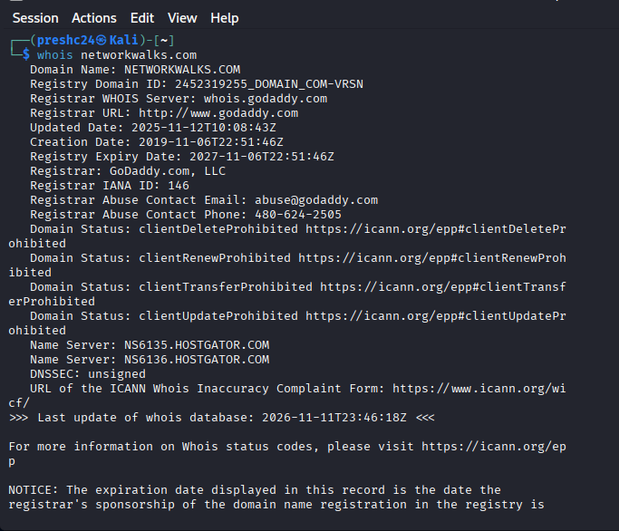
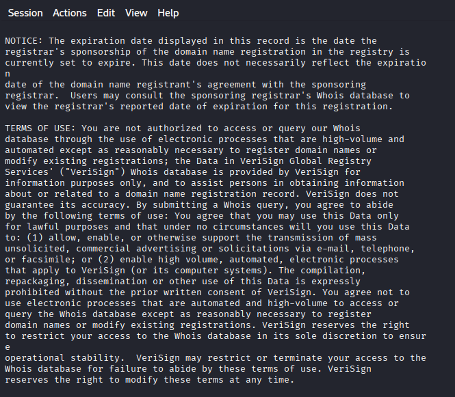
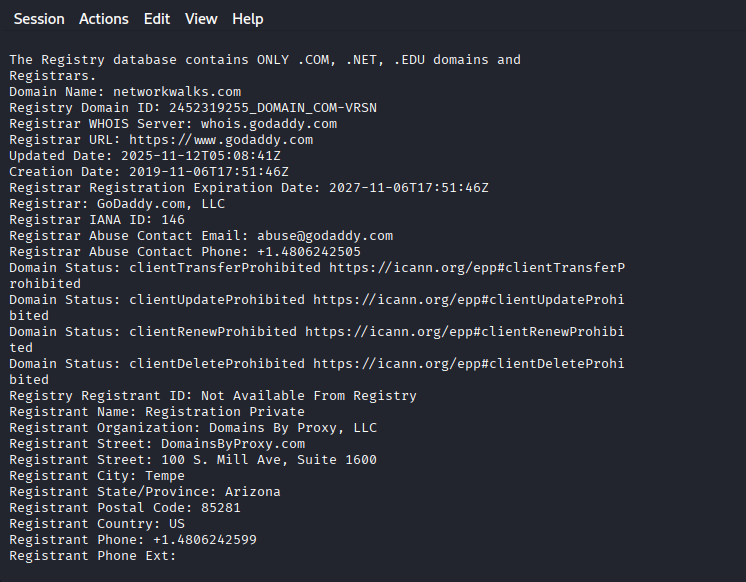
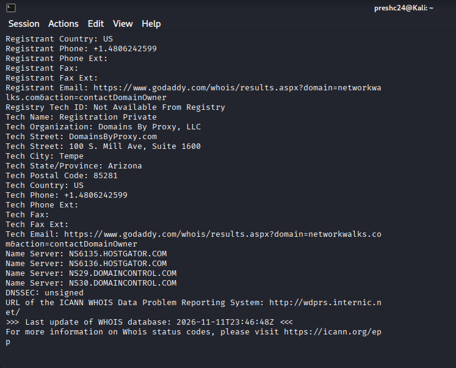
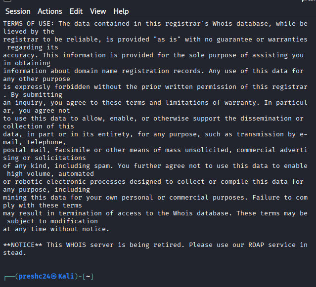
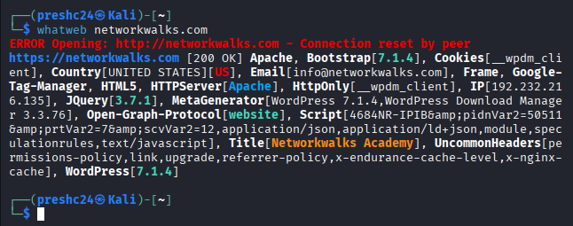
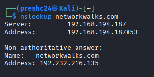
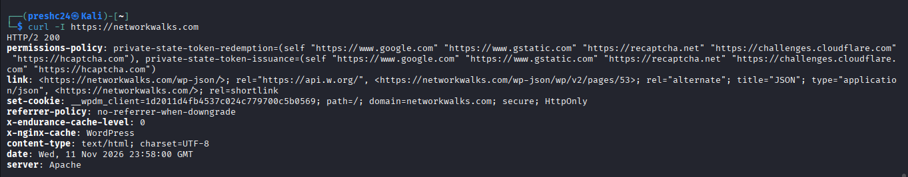
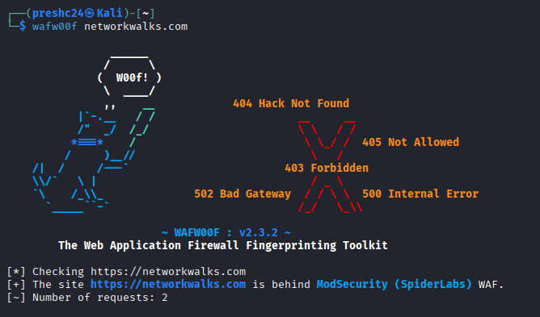
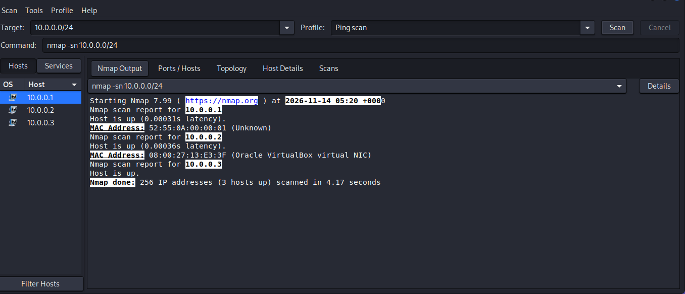
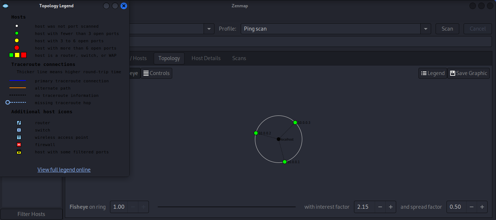

## 8. Lessons Learned

Through this practical exercise, I gained experience in:

- Domain reconnaissance and footprinting.
- Identifying website technologies.
- Understanding DNS records and domain infrastructure.
- Inspecting HTTP response headers.
- Detecting Web Application Firewalls.
- Performing network discovery using Zenmap.
- Interpreting reconnaissance findings.
- Documenting security observations and recommendations.

## 9. Conclusion

This practical exercise provided hands-on experience with reconnaissance, footprinting and network discovery using Kali Linux tools.

The exercise improved my understanding of how security professionals gather information about domains, identify web technologies, inspect DNS configurations and discover network devices.

It also reinforced the importance of obtaining authorization before conducting penetration testing activities and documenting findings responsibly.

## 10. Disclaimer

All testing activities documented in this repository were conducted for educational and authorized cybersecurity training purposes. Testing was performed within the scope of the permission granted. The information is shared for learning and portfolio documentation.

---
## 11.Final Report.

**Training Platform:** Networkwalks  
**Project Category:** Cybersecurity | Ethical Hacking | Footprinting | Network Reconnaissance  
**Author:** Chinenye Precious Ubosi

#Cybersecurity #EthicalHacking #KaliLinux #NetworkReconnaissance #Footprinting #Zenmap #DNSRecon #Networkwalks #CybersecurityLearning
